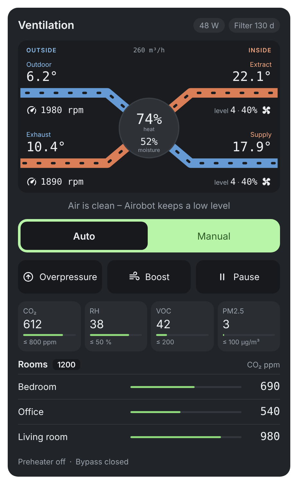
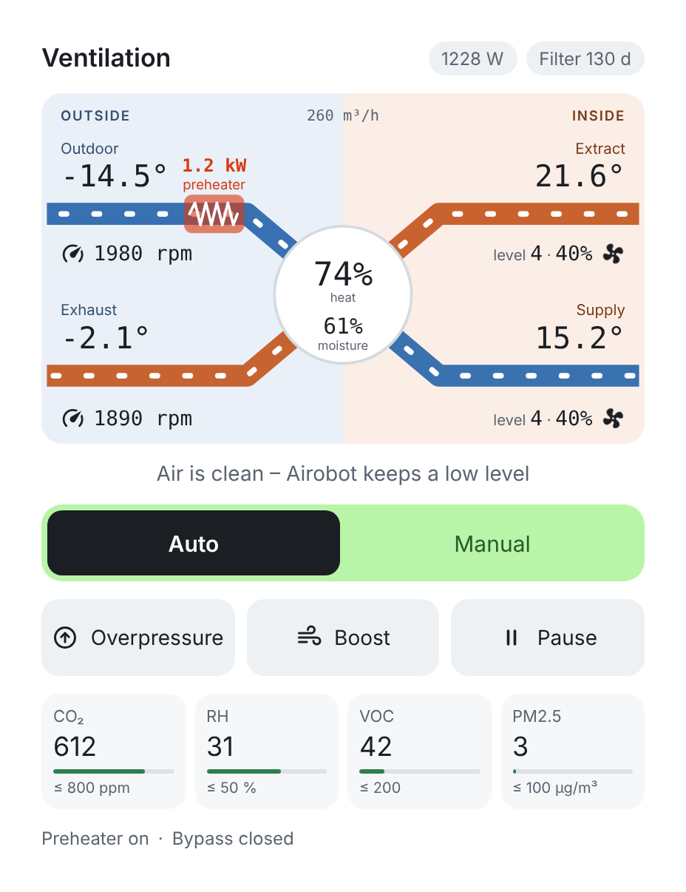
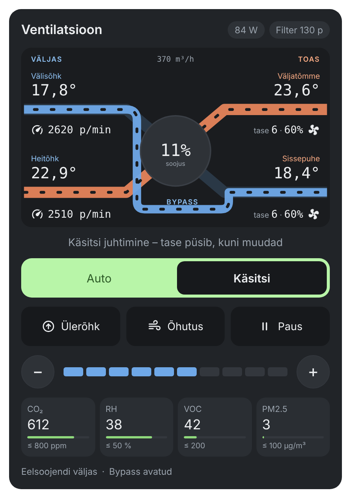

# Airobot Vent Card

[English](README.md) · **Eesti**

Home Assistanti Lovelace kaart Airoboti soojustagastusega ventilatsiooniseadmetele (L, L5, S1, S2, V3, V4, V6, V8), mis on ühendatud Modbus TCP kaudu.

| Tavaline töö | Talv: eelsoojendi sees | Suvi: bypass avatud |
|:---:|:---:|:---:|
|  |  |  |
| Tume teema, Auto režiim, toaandurite CO₂ | Hele teema, küttespiraal ja võimsus välisõhu kanalil | Bypass-kanal soojusvahetist mööda, käsitsi režiim taseme valikuga |

## Mida kaart näitab

- **Skeem:** välisõhk, sissepuhe, väljatõmme ja heitõhk. Kanalites liigub õhk ventilaatori taseme kiirusega, kumbki vool oma kiirusega. Ülerõhu ajal on väljatõmme aeglasem ja pausi ajal liikumine peatub.
- **Paigutus nagu klassikalisel ERV-kaardil:** iga kanali kohal on temperatuur. Välispoolsete kanalite all on ventilaatori pöörded (p/min, või m³/h, kui voolu õhuhulk on seadistatud). Toapoolsete kanalite all on tase protsentides ja ventilaatori ikoon, mis pöörleb ventilaatori kiirusega.
- **Rikke riba:** kui seade annab rikke, ilmub kaardi ülaossa punane riba vea nimega (tulekahjusignaal, ventilaator, andur, eelsoojendi, sissepuhe alla 5 °C või tundmatu bitt). Vead loetakse rikete bitimaskist (register 1026).
- **Eelsoojendi:** kui elektriline eelsoojendi töötab, ilmub välisõhu kanalile helendav küttespiraal koos võimsusega (W / kW).
- **Suvine bypass:** kui bypass on avatud, liigub välisõhk mööda eraldi BYPASS-kanalit soojusvahetist mööda ja soojusvaheti tee jääb tuhmiks.
- **Keskel:** soojustagastuse kasutegur ja niiskustagastus. Kogu õhuhulk on üleval keskel.
- **Režiim:** Auto ja Käsitsi. Taseme valik (+/−) on nähtaval ainult käsitsi režiimis.
- **Toimingud:** Ülerõhk (kamin), Õhutus (boost) ja Paus.
- **Õhukvaliteet:** CO₂, niiskus, VOC ja PM2.5 koos seadepunktiga. Riba muutub kollaseks 85 % juures ja punaseks üle seadepunkti. Näidatakse ainult neid näite, mille olem on olemas.
- **Toad:** toaandurite CO₂. Plokk on nähtav ainult siis, kui oled seadistuses lisanud `rooms` ja vastavad olemid on olemas.
- **Olekud:** elektritarve, filtri päevad, eelsoojendi ja bypass.
- **Hele ja tume teema:** `theme: auto` järgib HA teemat.
- **Keel:** eesti ja inglise. `language: auto` järgib HA keelt.

Igale väärtusele vajutades avaneb selle olemi ajalugu.

## Paigaldamine (HACS)

1. HACS → ⋮ → **Custom repositories** → URL `https://github.com/kaimo123/airobot-vent-card`, tüüp **Dashboard**.
2. Otsi „Airobot Vent Card“ ja vali **Download**.
3. Värskenda brauserit (Ctrl+F5).

Käsitsi paigaldamine: kopeeri `airobot-vent-card.js` kausta `/config/www/` ja lisa ressurss `/local/airobot-vent-card.js` (tüüp JavaScript module).

## Seadistus

### Visuaalne redaktor (YAML-i pole vaja)

1. Juhtpaneelil vali **Muuda → + Lisa kaart** ja otsi **Airobot Vent Card**.
2. Redaktoris on väljad jaotatud plokkidesse: **Toad**, **Temperatuurid**, **Ventilaatorid ja energia**, **Juhtimine**, **Õhukvaliteet**, **Olekud ja filter** ning **Täpsemalt**. Vali igale väljale olem rippmenüüst.
3. **Toad:** lisa toaandurite CO₂ olemid. Toa nimi võetakse olemi nimest. Plokk „Toad“ on kaardil ainult siis, kui vähemalt üks andur on lisatud.
4. Tühjaks jäetud väli peidab vastava osa kaardilt, näiteks PM2.5 või pausi nupu.

Seadistusse salvestatakse ainult need väärtused, mis vaikimisi nimedest erinevad, nii et YAML jääb lühikeseks.

### YAML

Kõige lihtsam kaart (vaikimisi olemid sobivad paketiga `airobot_v6.yaml`):

```yaml
type: custom:airobot-vent-card
```

Kõik valikud:

```yaml
type: custom:airobot-vent-card
name: Ventilatsioon
theme: auto              # auto | light | dark
mode_auto_option: Automaatne
mode_manual_option: Käsitsi
room_co2_limit: 1200
room_entities:           # valikuline – toa nimi võetakse olemi nimest
  - sensor.sininetuba_co2
  - sensor.soogituba_co2
rooms:                   # valikuline – kui tahad toale oma nime anda
  - name: Söögituba
    entity: sensor.soogituba_co2
entities:                # muuda ainult neid, mis erinevad vaikimisi nimedest
  outdoor_temp: sensor.airobot_valisohu_temperatuur
  supply_temp: sensor.airobot_sissepuhke_temperatuur
  extract_temp: sensor.airobot_valjatombe_temperatuur
  exhaust_temp: sensor.airobot_heitohu_temperatuur
  supply_level: sensor.airobot_sissepuhke_ventilaatori_tase
  exhaust_level: sensor.airobot_valjatombe_ventilaatori_tase
  supply_rpm: sensor.airobot_sissepuhke_ventilaatori_poorded
  exhaust_rpm: sensor.airobot_valjatombe_ventilaatori_poorded
  supply_airflow: null          # valikuline, näidatakse pöörete asemel
  exhaust_airflow: null
  airflow: sensor.airobot_ohuhulk
  efficiency: sensor.airobot_seadme_kasutegur
  moisture_recovery: sensor.airobot_niiskustagastus
  power: sensor.konkukilp_ventilatsioon_power
  co2: sensor.airobot_co2
  co2_setpoint: number.airobot_co2_seadepunkt
  humidity: sensor.airobot_valjatombe_niiskus
  humidity_setpoint: number.airobot_niiskuse_seadepunkt
  voc: sensor.airobot_voc_indeks
  voc_setpoint: sensor.airobot_reg_voc_seadepunkt
  pm25: sensor.airobot_pm2_5
  pm25_setpoint: sensor.airobot_reg_pm2_5_seadepunkt
  mode: select.airobot_reziim
  manual_level: number.airobot_kasitsi_tase
  boost: switch.airobot_boost
  overpressure: switch.airobot_ulerohk
  power_switch: switch.airobot_toide
  preheater: binary_sensor.airobot_eelsoojendi_sees
  preheater_power: sensor.airobot_eelsoojendi_voimsus   # valikuline
  bypass: binary_sensor.airobot_bypass_avatud
  filter_age: sensor.airobot_filtri_vanus
  filter_interval: sensor.airobot_filtri_intervall
  filter_alert: binary_sensor.airobot_filtri_vahetus
  errors: sensor.airobot_rikked      # bitimask (olek või atribuut `bitimask`) või tekst
  fault: binary_sensor.airobot_rike  # valikuline
```

Kui mõnda olemit pole, jäetakse vastav osa kaardilt välja: mõõtmine, nupp, toggle või olek. Olemi saab välja lülitada ka nii: `entities: { power: null }`.

## Märkused

- **Paus** lülitab `power_switch` välja (Airoboti coil 4000). Airoboti juhend ei luba seadet pikalt seisma jätta, seepärast käivitab pakett `airobot_v6.yaml` selle 30 minuti pärast uuesti.
- **Õhutus** (boost) ja **Ülerõhk** lõpevad Airoboti enda taimeri järgi (registrid 2010 ja 2012).

## Litsents

MIT
