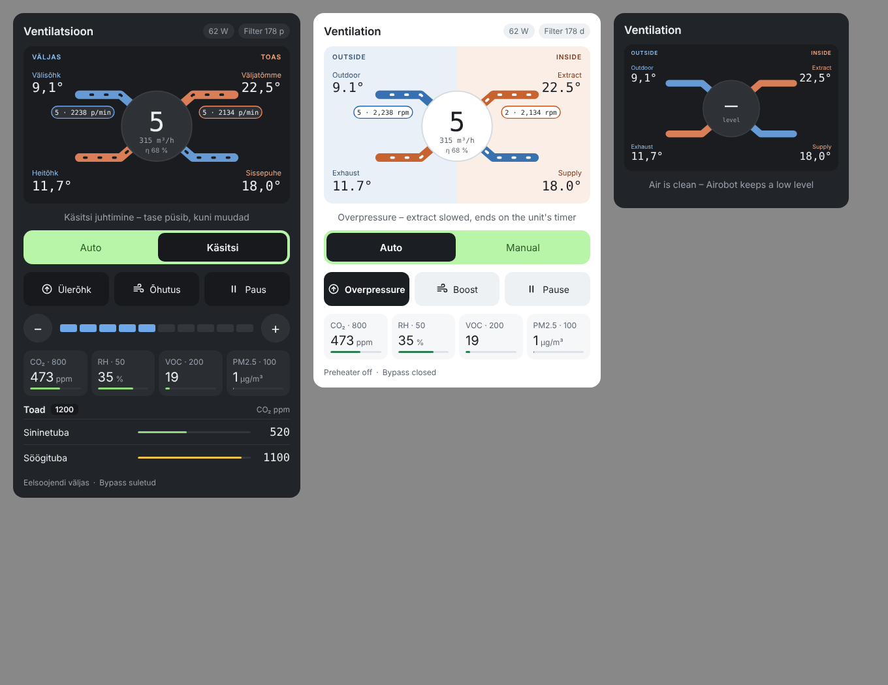

# Airobot Vent Card

**English** · [Eesti](README.et.md)

A Home Assistant Lovelace card for Airobot heat recovery ventilation units (L, L5, S1, S2, V3, V4, V6, V8) connected over Modbus TCP.



## Features

- **Animated schematic**: outdoor, supply, extract and exhaust air. Air moves through the ducts at the speed of each fan, so the supply and extract streams move independently. In overpressure mode the extract stream slows down, and when paused the movement stops.
- **Per-stream speed**: a label on the supply and the extract stream shows the fan level and its airflow (m³/h) or fan speed (rpm).
- **Fan level, airflow and heat recovery efficiency** in the centre of the schematic.
- **Mode**: Auto or Manual. The level stepper (+/−) is shown only in Manual mode.
- **Actions**: Overpressure (fireplace), Boost and Pause.
- **Air quality**: CO₂, humidity, VOC and PM2.5, each with its setpoint. The bar turns yellow at 85 % of the setpoint and red above it.
- **Rooms**: CO₂ from room sensors, such as Airobot TE1 -AQ thermostats or DT1. This section is shown only when room sensors are configured.
- **Status**: power consumption, days until filter change, preheater and bypass.
- **Light and dark theme**: `theme: auto` follows the Home Assistant theme.
- **Estonian and English**: `language: auto` follows the Home Assistant language.
- **Visual editor**: configure everything without YAML.

Any part of the card whose entity is missing is simply left out. Tap any value to open its history.

## Installation

### HACS (recommended)

1. HACS → ⋮ → **Custom repositories** → add `https://github.com/kaimo123/airobot-vent-card` with type **Dashboard**.
2. Search for **Airobot Vent Card** and select **Download**.
3. Reload the browser (Ctrl+F5).

### Manual

Copy `airobot-vent-card.js` to `/config/www/` and add the resource `/local/airobot-vent-card.js` (type: JavaScript module).

## Configuration

### Visual editor

1. On your dashboard select **Edit → + Add card** and search for **Airobot Vent Card**.
2. The fields are grouped into **Rooms**, **Temperatures**, **Fans and energy**, **Control**, **Air quality**, **Status and filter** and **Advanced**. Pick an entity for each field from the dropdown.
3. **Rooms**: add the room CO₂ sensors. The room name is taken from the entity name.
4. Leave a field empty to hide that part of the card, for example PM2.5 or the Pause button.

Only values that differ from the defaults are saved, so the YAML stays short.

### YAML

The default entity IDs match the Home Assistant package described below, so the minimal card is:

```yaml
type: custom:airobot-vent-card
```

All options:

```yaml
type: custom:airobot-vent-card
name: Ventilation          # default: "Ventilation" / "Ventilatsioon"
theme: auto                # auto | light | dark
language: auto             # auto | en | et
mode_auto_option: Automaatne   # option of the mode select entity that means Auto
mode_manual_option: Käsitsi    # option that means Manual
room_co2_limit: 1200
room_entities:             # optional, the name comes from the entity
  - sensor.bedroom_co2
  - sensor.dining_room_co2
rooms:                     # optional, use when you want your own room name
  - name: Living room
    entity: sensor.living_room_co2
entities:                  # override only what differs from the defaults
  outdoor_temp: sensor.airobot_valisohu_temperatuur
  supply_temp: sensor.airobot_sissepuhke_temperatuur
  extract_temp: sensor.airobot_valjatombe_temperatuur
  exhaust_temp: sensor.airobot_heitohu_temperatuur
  supply_level: sensor.airobot_sissepuhke_ventilaatori_tase
  exhaust_level: sensor.airobot_valjatombe_ventilaatori_tase
  supply_rpm: sensor.airobot_sissepuhke_ventilaatori_poorded
  exhaust_rpm: sensor.airobot_valjatombe_ventilaatori_poorded
  supply_airflow: null          # optional, shown instead of rpm
  exhaust_airflow: null
  airflow: sensor.airobot_ohuhulk
  efficiency: sensor.airobot_seadme_kasutegur
  power: sensor.konkukilp_ventilatsioon_power
  co2: sensor.airobot_co2
  co2_setpoint: number.airobot_co2_seadepunkt
  humidity: sensor.airobot_valjatombe_niiskus
  humidity_setpoint: number.airobot_niiskuse_seadepunkt
  voc: sensor.airobot_voc_indeks
  voc_setpoint: sensor.airobot_reg_voc_seadepunkt
  pm25: sensor.airobot_pm2_5
  pm25_setpoint: sensor.airobot_reg_pm2_5_seadepunkt
  mode: select.airobot_reziim
  manual_level: number.airobot_kasitsi_tase
  boost: switch.airobot_boost
  overpressure: switch.airobot_ulerohk
  power_switch: switch.airobot_toide
  preheater: binary_sensor.airobot_eelsoojendi_sees
  bypass: binary_sensor.airobot_bypass_avatud
  filter_age: sensor.airobot_filtri_vanus
  filter_interval: sensor.airobot_filtri_intervall
  filter_alert: binary_sensor.airobot_filtri_vahetus
```

Set an entity to `null` to hide it, for example `entities: { power: null }`.

## Entities the card expects

The card does not talk to the unit directly. It needs Home Assistant entities, typically created with the built-in [Modbus integration](https://www.home-assistant.io/integrations/modbus/) and Airobot's Modbus register map:

| Card field | Airobot register | Type |
|---|---|---|
| Temperatures (outdoor, supply, extract, exhaust) | 1003, 1002, 1001, 1004 (input, °C × 10) | sensor |
| Supply / extract fan level (0–10) | 1014, 1015 (input) | sensor |
| Supply / extract fan speed (rpm) | 1016, 1017 (input) | sensor |
| Supply / extract airflow | 1051, 1052 (input, constant-flow models) | sensor |
| Airflow | 1051 (input, constant-flow models) | sensor |
| Heat recovery efficiency | 1034 (input) | sensor |
| CO₂, humidity, VOC, PM2.5 | 1011, 1006, 1029, 1031 (input; read PM2.5 as 16-bit) | sensor |
| CO₂, humidity, VOC, PM2.5 setpoints | 2004, 2003, 2034, 2064 (holding) | number / sensor |
| Mode (1 = Auto, 2 = Manual) | 2000 (holding) | select |
| Manual level | 2005 (holding) | number |
| Power, Boost, Overpressure | coils 4000, 4004, 4005 | switch |
| Filter age / interval / alert | 2018, 2017 (holding), coil 4020 | sensor / binary_sensor |

Modbus TCP is off by default. Enable it on the VE1 controller (Settings → Other → Modbus TCP), or ask Airobot support. Use port 502, unit ID 1 and a timeout of at least 3 s, and connect only one Modbus client at a time.

## Notes

- **Pause** turns the power switch off (coil 4000). Airobot advises against leaving the unit off for long, so add an automation that switches it back on after a short time.
- **Boost** and **Overpressure** end on the unit's own timers (registers 2010 and 2012).

## License

MIT
